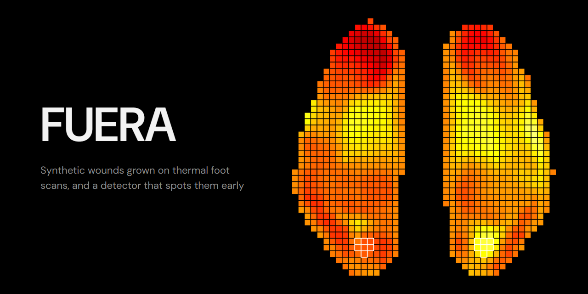
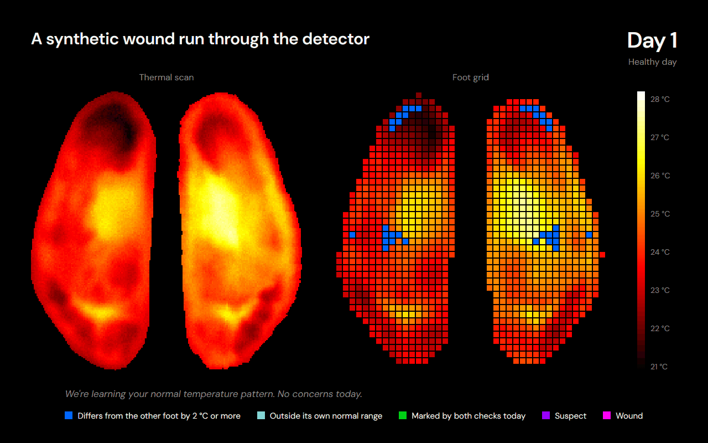
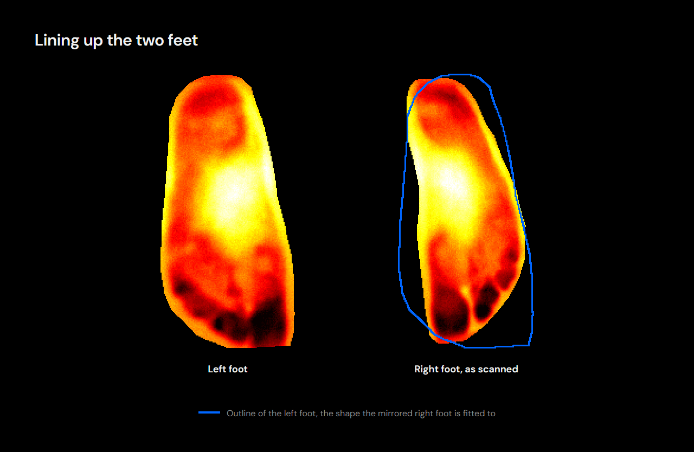
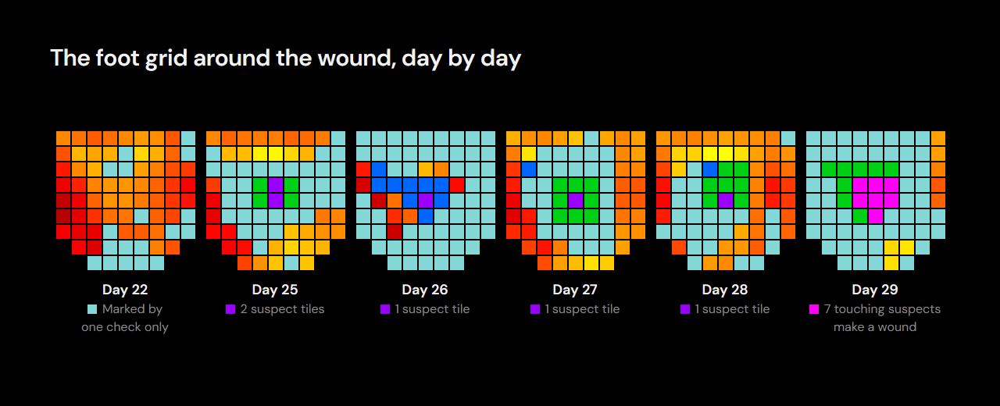

# FUERA

FUERA (Foot Ulcer Early Recognition Algorithm) is the proof of concept my team built for ZGT Hengelo, a hospital working on early detection of diabetic foot ulcers. It grows synthetic wounds on thermal images of healthy feet and tries to detect each one while it is still developing. I built how the synthetic wound is placed, sized and grown, and the detector's tile grid and left-versus-right check. ZGT asked for an algorithm that spots these wounds early in its Bath Mat's daily thermal scans, built on augmented data since nobody had scans of a forming wound.

Client project, team of 5, University of Twente • Design Project module (11) • September to November 2025 • Archived, not maintained

> [!NOTE]
> This is a research prototype, never clinically validated, so it must not be used to diagnose or treat anyone. It doesn't run from this repo, because the thermal scans it needs stay with ZGT.

## Results / Demo

We had no real pre-ulcer scans to test against, so ZGT judged the generated wounds by eye. Five random wounds scored 15 of 25 for realism, with the plain circle rated lowest and the many-blob wounds read as the most realistic. ZGT put three of four shuffled growth sequences back in order, one with a single swap, and took a natural warm spot for the wound in the fourth.

## How it works

FUERA has two Python scripts that run one after the other, a generator that writes a synthetic wound series and a detector that reads it. They share no code and pass data only through the `.mat` files that the generator saves, one per day.

ZGT gave us 8 to 11 days of thermal scans of 15 healthy people, of the soles and the tops of both feet, taken with its Bath Mat. On each person's first day, `generate_heatspot_mask_model.py` mirrors the right foot onto the left and rotates, scales and slightly warps it with PyTorch until their outlines overlap best. It reuses that alignment for every later day and copies temperatures pixel by pixel, so aligning never changes them. The alignment was needed because the camera saw the two feet from different angles.

The generator then stretches each person's real days into a longer series by repeating them, with healthy days first, growth days next and full-strength days last. It puts the wound on a random foot and in a region weighted by where diabetic ulcers form most often, following Cowley et al. (2008). The wound is a circle or a cluster of overlapping blobs, with a hot core inside a warm ring. We built wounds from rules because a generative model such as StyleGAN needs thousands of training images, and ZGT had 146 healthy scans.

Over the growth days the wound grows from a speck to its full size and warms evenly. Its core and ring both end 3 °C warmer than the same spot on the other foot, blended into the scan with a Gaussian blur. For every day the generator saves both feet as a `.mat` file and an image.

`detect_wounds_both.py` reads the series day by day and cuts both feet into small square tiles. The literature, ZGT's Bath Mat study and an author we interviewed agreed that a 2.2 °C difference between the same spot on both feet is the only validated warning sign. The contralateral check marks a tile that differs from the same tile on the other foot by 2.0 °C or more. The unilateral check, modeled on Lavery et al. (2019), learns each tile's normal range from healthy days at the start and marks a tile that leaves that range.

A tile becomes a suspect when its marks keep coming back over several days, and it has to be a suspect in both checks. ZGT asked for that second check because the first one alone raised false alarms. Three touching suspects count as a wound, and the detector stops on that day. It writes an image per day with the tiles colored by what marked them, plus a plain-language log for the patient.

Built with: Python, PyTorch 2.8.0, NumPy 2.3.3, SciPy 1.16.1, scikit-image 0.25.2, Matplotlib 3.10.6, Pillow 11.3.0, Jupyter, pytest

## My contribution

I worked out how to read ZGT's MATLAB scan files and plot them. In the generator I built where the wound goes, its size and temperature settings, and how it grows over the days. In the detector I built the tile grid and the contralateral check, joined both checks into one script and drew the daily images. I also wrote the report's sections on those parts and made the group's poster, which is in `docs/`.

The rest of the team had one member on the foot segmentation, wound placement and shapes and the StyleGAN research, and one on the foot alignment and unit tests. One more built the unilateral check and the warping step and wrote the report's literature review and researcher interview, and one worked on the detection algorithm.

## Project structure

| File | Purpose |
|---|---|
| [`src/generate_heatspot_mask_model.py`](src/generate_heatspot_mask_model.py) | Aligns each person's feet, grows a wound over the series and saves each day |
| [`src/foot_overlay_creator_simplified2.py`](src/foot_overlay_creator_simplified2.py) | Mirrors, rotates, scales and overlays the feet, and runs a standalone overlay demo |
| [`src/foot_part_identifier.py`](src/foot_part_identifier.py) | Splits a foot into heel, midfoot and front |
| [`src/detect_wounds_both.py`](src/detect_wounds_both.py) | Runs both checks day by day and writes the images and the patient log |
| [`src/generate_heatspot_mask.py`](src/generate_heatspot_mask.py) | Adds a wound to one person's scans, the earlier generator that the tests import |
| [`src/testGenerateHeatspotMask.py`](src/testGenerateHeatspotMask.py) | Tests adding wound heat to synthetic arrays (pytest) |
| [`src/thermal_Image_handler.py`](src/thermal_Image_handler.py) | Draws a thermal image from temperatures stored as JSON, for the tests |
| [`src/process_mat_files.py`](src/process_mat_files.py) | Plots one person's soles side by side, day by day |
| [`src/consistent_process_mat_files.py`](src/consistent_process_mat_files.py) | Plots an original and a modified scan on one temperature scale |
| [`src/convert_mat_files.py`](src/convert_mat_files.py) | Converts `.mat` scans to JSON |
| [`src/diabetes.ipynb`](src/diabetes.ipynb) | Lists what one `.mat` file holds |
| [`docs/design-report.pdf`](docs/design-report.pdf) | Documents the research, design and validation, with names and third-party figures removed |
| [`docs/poster.png`](docs/poster.png) | Summarizes the project on the group's poster |
| [`requirements.txt`](requirements.txt) | Pins the team's Python packages |
| [`assets/`](assets) | Holds the README's images |

The code is the team's as it stood when the module ended, with one notebook output removed because it showed a teammate's file path.

#### Not included in this archive

- ZGT's thermal scans, which the scripts read from `Data/Temp Data/`, and everything generated from them. The scans belong to ZGT, and only the healthy participants' images in this README and in `docs/` are public.
- The scans of patients with an existing ulcer, which two helper scripts point to and the pipeline didn't use.
- The final presentation, because the poster and this README cover what it showed.

## Known issues and limitations

- Section 6.4 of the design report sets the contralateral threshold to 2.2 °C, but the code uses the lower value, so it marks more tiles than the report describes.
- Every wound on the top of the foot lands at the front, because a condition in the region picker (`if 0.754:`) is always true.
- The pinned NumPy and SciPy need Python 3.11 or newer, while the team's notebooks ran on Python 3.10.7.
- The unit tests check temperature arithmetic on synthetic arrays and never call the generator or the detector.
