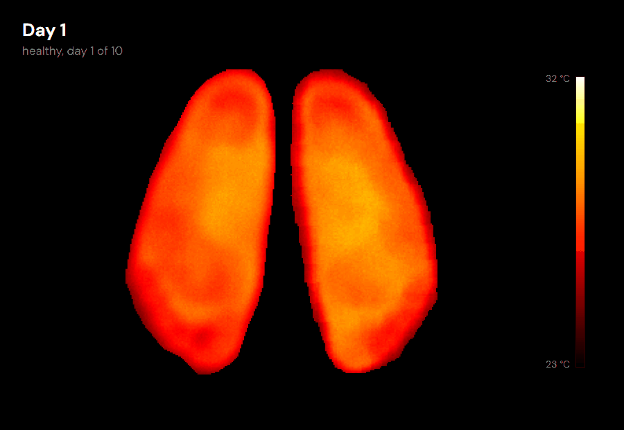
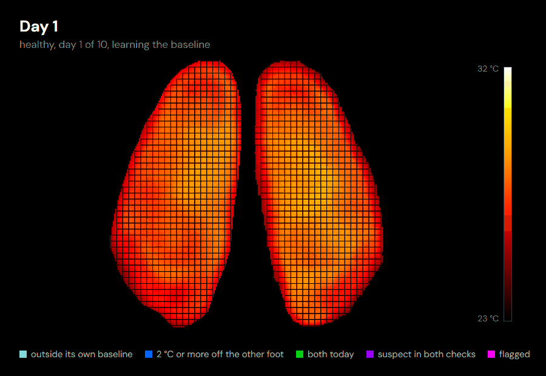
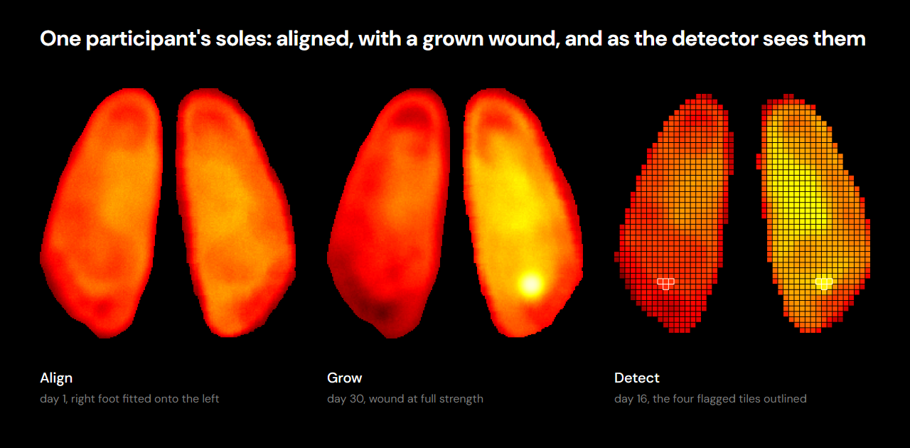
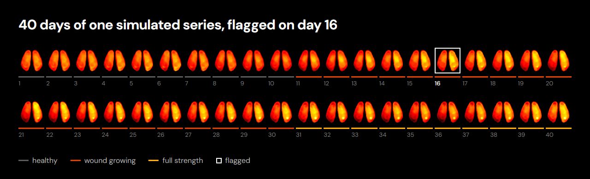
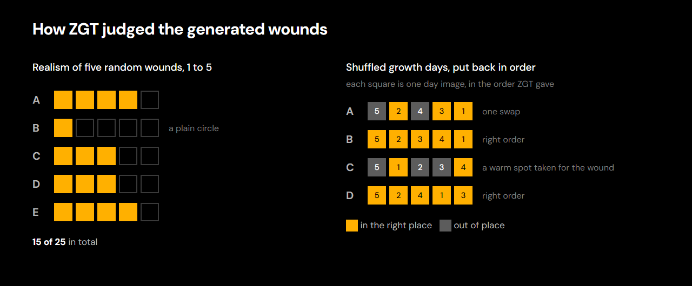

# FUERA

FUERA is the proof of concept my team built for ZGT Hengelo. It grows synthetic wounds on thermal images of healthy feet and tries to detect each one while it is still developing. I built how the synthetic wound is placed, sized and grown, and in the detector I built the tile grid and the left-versus-right check and joined the two checks into one script.

Design project, Technical Computer Science, University of Twente · module 11, September to November 2025 · team of 5 · client: ZGT Hengelo

> [!WARNING]
> This is a research prototype and not a medical device. It hasn't been clinically validated and must not be used to diagnose or treat anyone. The repo is a snapshot of the pipeline code, and it doesn't run as it is because the thermal scans it needs stay with ZGT.

## Demo

Both GIFs come from one run on the soles of one healthy participant (gz1), with a wound that grows for 20 days on the right foot: first the whole synthetic series, then what the detector marks each day until it fires.

## How it works

ZGT gave us 10 days of thermal scans of 15 healthy participants, of the soles and the tops of both feet, taken with the Bath Mat, a thermal camera mat meant for patients' homes. Nobody has thermal images of a diabetic foot wound while it forms, so the project had to make that data first and then detect the wound in it.

`generate_heatspot_mask_model.py` lines the right foot up with the left once per person, on the first day, and reuses that alignment for every later day. It mirrors the right foot, tries rotations from -30° to 30° in 0.5° steps, scales it to the left foot's size and then warps it slightly with a displacement field that PyTorch optimises for overlap. Temperatures are copied pixel by pixel (nearest neighbour), so the alignment doesn't change them.

The same script stretches each person's 10 real days to a 40-day series by interpolating between them: 10 healthy days, 10 to 30 days of growth (20 in 60% of runs) and 10 days at full strength. It picks the foot and the region. On the soles the front of the foot gets 74.4% of wounds, the heel 20.6% and the midfoot 5%, following Cowley et al. (2008). On the tops of the feet a condition in the code (`if 0.754:`) is always true, so every dorsal wound lands at the front of the foot. The wound is a circle or a cluster of 20 to 50 overlapping blobs, with a hot core and a warmer ring around it. Over the growth days it grows from 5% to its full size and warms linearly until the core is 3.0 °C and the ring 2.25 °C warmer than that spot was. The wounded foot can also warm or cool as a whole, to mimic blood vessels widening or narrowing.

`detect_wounds_both.py` cuts both feet into 5 x 5 pixel tiles and runs two checks every day. The contralateral check compares each tile with the same tile on the other foot and marks it when they differ by 2.0 °C or more (the literature's warning value is 2.2 °C). A tile marked on 3 of the last 5 days becomes a suspect. The unilateral check learns each tile's normal range from 5 of the first 10 days (median and scaled MAD) and marks a tile that falls outside it 3 days running. A tile has to be a suspect in both checks, and 3 touching ones make a wound. The detector stops at the first wound it finds and writes a plain-language log for the patient alongside the daily images.

## Results

We had no real pre-ulcer data to test against, so ZGT judged the output by eye.

The wounds built from many blobs read as the most realistic.

## My part

I worked out how to read ZGT's MATLAB files and plot them, and that plotting is what the rest of the pipeline uses. In the wound generation I built where the wound goes, its size, shape and temperature variables, and how it grows over the days. In the detector I built the tile grid and the contralateral check, joined the contralateral and unilateral checks into one script and made the daily images. I also made the group's poster.

Of the other four, one built the foot segmentation and worked on the wound generation with me (the placement probabilities and the wound shapes), one built the foot alignment and the unit tests, one built the unilateral check and the warping step, and one worked on the detection algorithm.

## What's in here

| File | Purpose |
|---|---|
| [`src/generate_heatspot_mask_model.py`](src/generate_heatspot_mask_model.py) | The generator: aligns each person's feet, picks the wound's foot, region, shape and size, grows it over the series and writes one `.mat` file and one image per day |
| [`src/foot_overlay_creator_simplified2.py`](src/foot_overlay_creator_simplified2.py) | The mirror, rotation, scaling and overlap helpers the alignment uses, plus a standalone overlay demo |
| [`src/foot_part_identifier.py`](src/foot_part_identifier.py) | Splits a foot into heel, midfoot and front |
| [`src/detect_wounds_both.py`](src/detect_wounds_both.py) | The detector: tile grid, both checks, wound clusters, daily images and the patient log |
| [`src/generate_heatspot_mask.py`](src/generate_heatspot_mask.py) | The earlier wound generator, which the unit tests test |
| [`src/testGenerateHeatspotMask.py`](src/testGenerateHeatspotMask.py) | Unit tests for the wound masks (pytest) |
| [`src/thermal_Image_handler.py`](src/thermal_Image_handler.py) | Test helper that draws a thermal image from temperatures stored as JSON |
| [`src/process_mat_files.py`](src/process_mat_files.py) | Plots one participant's soles side by side, day by day |
| [`src/consistent_process_mat_files.py`](src/consistent_process_mat_files.py) | Plots an original and a modified scan on the same temperature scale |
| [`src/convert_mat_files.py`](src/convert_mat_files.py) | Converts `.mat` scans to JSON |
| [`src/diabetes.ipynb`](src/diabetes.ipynb) | A first look at what one `.mat` file holds |
| [`requirements.txt`](requirements.txt) | The team's pinned Python packages |
| [`assets/`](assets) | The images in this README |

The code is unchanged from the team's repository. It expects ZGT's scans in `Data/Temp Data/`.

## What's not here

- ZGT's thermal scans and everything generated from them, apart from the images in this README, which show one healthy participant (gz1) with a synthetic wound.
- The scans of patients with an existing ulcer, which the pipeline didn't use.
- The design report and the presentations, which carry student numbers and the client's material.
- Older versions of the detector and the foot alignment, a script that reads the old alignment's output, and two early prototype notebooks.
